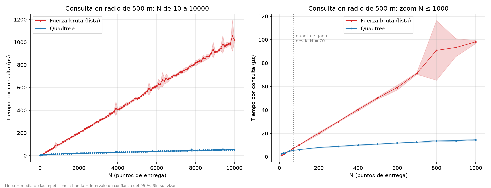
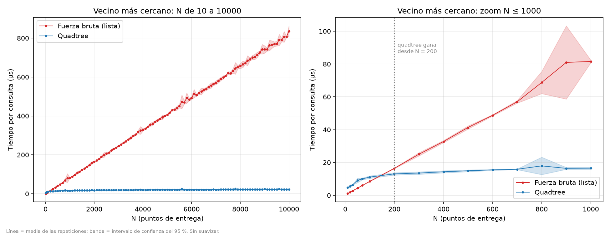
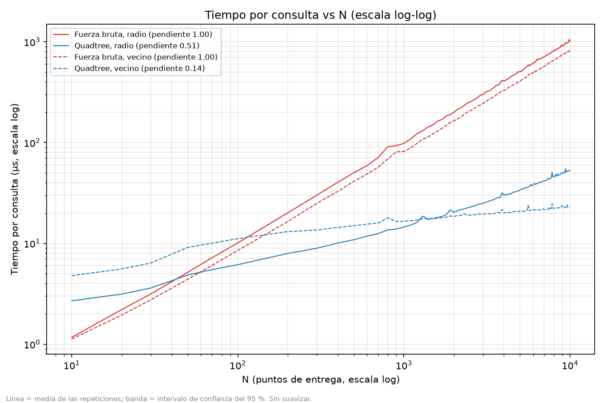
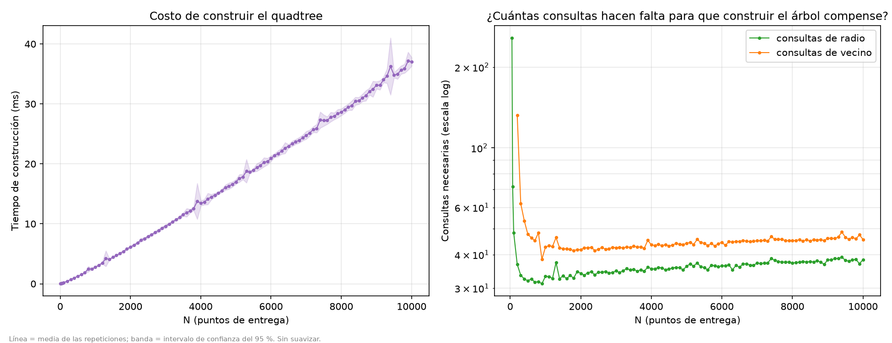

# Quadtree para logística: búsquedas espaciales en una ciudad

**Integrante:** <Jesica Alejandra Estor Soto – 1082890547>

Un sistema de logística necesita responder dos preguntas sobre puntos de entrega en una ciudad:
qué puntos hay a menos de 500 m de un lugar (por ejemplo, para asignarlos a un repartidor) y cuál
es el punto más cercano a un lugar dado. Implementamos un **Quadtree** en 2D desde cero y lo
comparamos con la **fuerza bruta** (recorrer la lista completa de puntos).

## Archivos

| Archivo | Qué hace |
|---|---|
| `QuadTree.py` | Clases `Punto`, `Rectangulo` y `Quadtree` (`insertar`, `query_radius`, `nearest_neighbor`), las versiones de fuerza bruta y el generador de la ciudad. |
| `test.py` | Genera 10 000 puntos, comprueba que el quadtree da lo mismo que la fuerza bruta y hace las dos gráficas de visualización. |
| `analisis.py` | Benchmark quadtree vs fuerza bruta, estadísticas y gráficas. |

## Cómo correrlo

```bash
pip install matplotlib          # en Windows: py -m pip install matplotlib

python test.py                  # verificación + grafica_radio.png y grafica_vecino.png
python analisis.py --rapido     # prueba corta (~10 s) para ver que todo funciona
python analisis.py              # benchmark completo (~15-20 min); cerrar todo lo demás
python analisis.py --solo-graficas   # rehace estadísticas y gráficas sin volver a medir
```

Resultados: `resultados/mediciones.csv` (cada medición), `resultados/resumen.md` (tablas) y `graficas/`.

## Cómo funciona

- **Ciudad:** 10 km × 10 km, coordenadas en metros. Para que no sea uniforme, el 70 % de los puntos
  está en 8 "barrios" (distribución normal alrededor de un centro) y el 30 % repartido al azar.
- **Quadtree:** cada nodo cubre un rectángulo. Guarda hasta 8 puntos (`capacidad`); al llenarse se
  divide en 4 (`nw`, `ne`, `sw`, `se`) y los puntos bajan a los hijos. Las zonas densas quedan con
  cuadros pequeños y las vacías con cuadros grandes (ver `grafica_radio.png`).
- **`query_radius`:** si el círculo no toca el rectángulo de un nodo, ese nodo y todos sus hijos se
  descartan sin mirar sus puntos.
- **`nearest_neighbor`:** visita primero los hijos más cercanos y descarta cualquier nodo cuyo
  rectángulo esté más lejos que el mejor punto encontrado hasta ahora.
- **Fuerza bruta:** una *list comprehension* (radio) y un `for` (vecino) sobre la lista. Usan la
  misma fórmula que el quadtree (`dx*dx`, no `**2`), porque en Python `**2` es más lento y la
  comparación no sería justa.
- `test.py` comprueba en 1 000 consultas al azar que ambos métodos devuelven exactamente lo mismo.

## Metodología del benchmark

- **N:** de 100 a 10 000 de 100 en 100, más N = 10, 20, 30, 50 y 70 (el cruce de la búsqueda en
  radio cae por debajo de 100).
- **5 repeticiones por N,** cada una con una ciudad distinta (semilla = número de repetición).
- **Ventanas de al menos 0.3 s:** cada medición repite consultas (con centros nuevos al azar,
  generados fuera del cronómetro) hasta acumular 0.3 s, y se divide. Con 1 s el experimento
  duraría más de 45 minutos; en nuestro laboratorio anterior, las mediciones de más de 100 ms ya
  tenían un CV mediano de ~3 %.
- **Lo mismo para todos:** quadtree y fuerza bruta buscan exactamente los mismos centros.
- **Orden aleatorio** de los N y de las 5 mediciones dentro de cada N, para que un cambio de
  velocidad del computador no se confunda con el efecto de N.
- Recolector de basura apagado mientras se mide; `time.perf_counter()`.
- Se mide también **construir el quadtree** y se calcula cuántas consultas hacen falta para que
  construirlo compense: `t_construir / (t_fuerza_bruta − t_quadtree)`.
- Estadística: media, desviación estándar, CV, IC del 95 % (t de Student) y pendientes log-log.
  "El quadtree gana desde N" = desde ese N sus IC no se tocan con los de la fuerza bruta.

**Equipo:** portátil con AMD Ryzen serie 5000 (16 núcleos lógicos), 16 GB de RAM, Windows 11,
Python 3.13.7, conectado a la corriente. El experimento completo duró 15.1 minutos.

## Resultados

Tablas completas en `resultados/resumen.md` y `resultados/estadisticas.csv`. Tiempos por consulta.

| | Radio de 500 m | Vecino más cercano |
|---|---|---|
| El quadtree gana desde (IC 95 % separados) | **N = 70** | **N = 200** |
| N donde gana la fuerza bruta | 10, 20, 30 (empate en 50) | 10 a 100 |
| N = 10: quadtree vs fuerza bruta | 2.69 vs 1.17 µs (lista 2.3× más rápida) | 4.78 vs 1.12 µs (lista 4.3× más rápida) |
| N = 10 000: quadtree vs fuerza bruta | 52.95 vs 1 018.74 µs (quadtree 19× más rápido) | 22.90 vs 835.64 µs (quadtree 36× más rápido) |
| Pendiente log-log del quadtree | 0.51 | 0.145 |
| Pendiente log-log de la fuerza bruta | 1.00 | 1.00 |
| Consultas para que construir compense (N ≥ 500) | 32 a 39 | 42 a 48 |

Construir el quadtree tarda 37 ms con N = 10 000 (pendiente 1.126) y el árbol llega a 9 niveles.
Una consulta de radio devuelve en promedio 0.1 puntos con N = 10 y 80.2 con N = 10 000.


*Tiempo por consulta de radio. Derecha: zoom de N ≤ 1 000 con el cruce en N = 70.*


*Tiempo por consulta de vecino más cercano. Derecha: zoom con el cruce en N = 200.*


*Las cuatro curvas en escala log-log, con su pendiente en la leyenda.*


*Izquierda: tiempo de construir el quadtree. Derecha: consultas necesarias para que construirlo compense.*

**Ruido:** CV mediano de 1.6 % y máximo de 25.1 %. La mediana del tiempo relativo (medición /
mediana de su N) fue 1.000 en los cuatro cuartos del experimento.

## Discusión

**¿Desde qué N es más rápido el quadtree?** Desde N = 70 en búsqueda por radio y desde N = 200 en
vecino más cercano. Por debajo gana la fuerza bruta: con N = 10, la lista es 2.3 veces más rápida en
radio y 4.3 veces en vecino. Con N = 10 000 la situación se invierte: el quadtree es 19 y 36 veces
más rápido.

**¿Por qué con pocos datos gana la lista?** Cada consulta del quadtree hace llamadas recursivas y
revisa rectángulos; en el vecino más cercano, además, ordena los 4 hijos con `sorted` en cada nodo.
Recorrer 10 puntos en una lista es más barato que todo eso. Por eso el vecino más cercano necesita
más puntos (200) que el radio (70) para ganar. Nos sorprendió que el cruce fuera tan bajo: también
influyó que la comparación fuera justa (con `**2` en la fuerza bruta, el quadtree ganaba siempre).

**¿Siempre conviene el quadtree?** No. Construirlo cuesta (37 ms con N = 10 000), y hacen falta entre
32 y 48 consultas para recuperar ese tiempo. Si solo se va a hacer una consulta, la fuerza bruta
siempre gana, aunque N sea 10 000. El quadtree conviene cuando se construye una vez y se consulta
muchas veces, que es el caso de un sistema de logística. Además, ese número sube despacio con N
(de 32 a 39 en radio), porque construir crece como N log N y el ahorro por consulta como N.


**Ruido y cosas que no esperábamos.**
- **Picos aislados: cada uno es una sola repetición lenta.** Revisamos `mediciones.csv`. De 2 625
  mediciones, solo 24 (0.9 %) quedaron más de 20 % por encima de la mediana de su N, repartidas en
  15 de las 525 combinaciones (N, repetición). Cada pico de las gráficas corresponde a una de ellas:
  - N = 800, repetición 1: búsqueda por radio con fuerza bruta en 126.6 µs, contra 78.7 a 90.6 µs en
    las otras cuatro. Esa sola repetición sube la media de 79.5 µs (mediana) a 90.9 µs.
  - N = 3 900, repetición 4: cuatro de sus cinco mediciones entre 27 % y 49 % más lentas.
  - N = 9 400, repetición 3: construir 24 % y radio con quadtree 39 % más lentos.
  - Los picos menores del quadtree en N = 1 300, 5 600 y 7 800 son, cada uno, otra repetición aislada.

  En 14 de esas 15 combinaciones solo una o dos de las cinco mediciones salieron lentas. Como las
  cinco se hacen seguidas (más de 1.5 s en total), lo más probable es que fueran interrupciones del
  sistema operativo más cortas que eso, que afectaron solo a la medición que corría en ese momento;
  N = 3 900 sería una más larga. No fue una lentitud sostenida: las mediciones lentas aparecen en
  los cuatro cuartos del experimento y la mediana del tiempo relativo fue 1.000 en todos. Ninguna
  de las 15 combinaciones está en N = 50, 70, 100 ni 200, así que los cruces no dependen de ellas.
- **Las dos fuerzas brutas son O(N), pero la de radio es 22 % más lenta** con N = 10 000 (1 019 vs
  836 µs). Su *list comprehension* calcula `p.x - x` y `p.y - y` dos veces cada una y arma una lista
  con los resultados. Esto la deja en ligera desventaja, aunque no cambia el cruce: con los tiempos
  de la fuerza bruta de vecino, seguiría ganando en N = 50 y perdiendo en N = 70.

## Limitaciones

- Medido en Python en un solo computador: valen las tendencias, no los tiempos absolutos.
- Solo 2D; una ciudad sintética; capacidad de nodo fija (8); radio fijo (500 m).
- 5 repeticiones por N: los intervalos de confianza son anchos donde hubo una repetición atípica.
- La fuerza bruta de radio repite cálculos por punto (ver Discusión).

## Uso de IA

Se utilizo IA para generar el analisis estadistico de los resultados y gráficas, verificar el codigo creado para el QuadTree y ayudar a redactar este README.

## Webgrafía

- Wikipedia. (s. f.). *Quadtree*.  https://en.wikipedia.org/wiki/Quadtree
- hypersphere. (25 de abril de 2025). *Introduction to Quad Trees*. hypersphere blog. https://hypersphere.blog/blog/quad-trees/
- Software Interviews Prep. (17 de diciembre de 2024). *Quad Tree | Location-Based Services Explained | The Art of System Design* [Video]. YouTube. https://www.youtube.com/watch?v=-EPIGbpFb_c

